# Hệ thống chấm công định vị 3D theo khối không gian phân tầng

**Đồ án môn học IE402 — Hệ thống thông tin địa lý 3 chiều**

> Tên đề tài đề xuất (dùng cho bìa):
> **“Xây dựng hệ thống chấm công định vị dựa trên mô hình khối không gian 3 chiều
> phân tầng cho toà nhà văn phòng”**

---

# Chương 1: TỔNG QUAN, ĐẶT VẤN ĐỀ, Ý NGHĨA VÀ MỤC TIÊU

## 1.1. Tổng quan

Chấm công định vị (geolocation-based attendance) là hình thức xác nhận sự có mặt của
người lao động bằng toạ độ thiết bị di động thay cho máy chấm công vân tay/thẻ từ. Mô
hình này bùng nổ sau giai đoạn làm việc linh hoạt: doanh nghiệp có nhiều chi nhánh,
nhân viên đi công trường, nhân viên kinh doanh di chuyển liên tục — việc bắt tất cả về
một máy chấm công vật lý là không khả thi.

Hầu hết ứng dụng chấm công định vị hiện nay (bao gồm các sản phẩm thương mại phổ biến
tại Việt Nam) đều dùng **hàng rào địa lý hai chiều (2D geofence)**: một hình tròn bán
kính R quanh một toạ độ, hoặc một đa giác phẳng. Hệ thống chỉ trả lời được câu hỏi
*“người này có đứng trong vùng không?”* trên mặt phẳng.

## 1.2. Đặt vấn đề

Hàng rào 2D thất bại trong chính bối cảnh mà chấm công định vị được dùng nhiều nhất —
**toà nhà văn phòng cao tầng ở đô thị**:

**(a) Không phân biệt được theo chiều cao.** Một cao ốc 30 tầng có hàng chục doanh
nghiệp thuê các tầng khác nhau. Nhân viên công ty A (tầng 5) và nhân viên công ty B
(tầng 22) có **cùng một toạ độ `lat/lon`**. Hàng rào 2D chấp nhận cả hai như nhau. Tệ
hơn: một người ngồi ở quán cà phê tầng trệt, hoặc ở hầm giữ xe, vẫn “chấm công hợp lệ”
cho văn phòng tầng 22.

**(b) Sai số GPS trong đô thị (urban canyon).** Tín hiệu vệ tinh bị các khối nhà cao
tầng chắn và phản xạ nhiều đường (multipath), sai số ngang có thể lên tới hàng chục
mét — đủ để một người ở toà nhà kế bên vẫn lọt vào hàng rào. Trên mặt phẳng 2D không
có cách nào giải thích hay khoanh vùng hiện tượng này; phải có mô hình khối của các
công trình xung quanh mới phân tích được vùng bị che khuất.

**(c) Không phát hiện được gian lận theo chiều đứng.** Các thủ thuật phổ biến — dùng
ứng dụng giả lập vị trí (fake GPS), nhờ đồng nghiệp chấm hộ ngay dưới sảnh — đều tạo
ra bản ghi “đúng toạ độ” nhưng **sai độ cao** hoặc sai quy luật di chuyển. Dữ liệu
2D không giữ được thông tin để phát hiện.

**(d) Không trực quan hoá được để kiểm tra.** Khi có tranh chấp công, người quản lý
cần *nhìn thấy* nhân viên đã chấm công ở đâu. Chấm điểm trên bản đồ phẳng không nói
được điểm đó nằm trong hay ngoài khối văn phòng.

## 1.3. Ý nghĩa và mục tiêu của đề tài

**Ý nghĩa.** Đề tài chuyển bài toán chấm công từ *“điểm thuộc đa giác”* (2D) sang
*“điểm thuộc khối”* (3D), qua đó xử lý được lớp bài toán mà hệ thống 2D không giải
quyết được: phân biệt doanh nghiệp theo tầng trong cùng một cao ốc, và kiểm chứng tính
hợp lệ của bản ghi chấm công theo chiều đứng.

**Mục tiêu cụ thể.**

| # | Mục tiêu | Tiêu chí hoàn thành |
|---|---|---|
| M1 | Xây dựng mô hình dữ liệu 3D cho vùng chấm công phân tầng | Mô hình MAP (mục 2.2) được định nghĩa hình thức và cài đặt trong CSDL không gian |
| M2 | Cài đặt thuật toán kiểm tra “điểm thuộc khối” có xét sai số | Hàm kiểm tra trả về `hợp lệ / ngoài vùng / nghi ngờ`, thời gian < 200 ms |
| M3 | Ứng dụng web cho 3 vai trò: nhân viên, quản lý, quản trị | Đủ luồng chấm công – duyệt – báo cáo |
| M4 | Trực quan hoá 3D bản ghi chấm công trên nền toà nhà dựng khối | SceneView hiển thị khối văn phòng + điểm chấm công theo cao độ |
| M5 | Phát hiện 4 dạng bất thường (mục 2.2.3) | Sinh cảnh báo kèm mức độ |
| M6 | Cho phép quản trị viên **vẽ khối vùng chấm công ngay trên bản đồ 3D** | Công cụ dựng prism + nhập `z_min`, `z_max` |

---

# Chương 2: PHÂN TÍCH VÀ MÔ HÌNH HOÁ

## 2.1. Cơ sở lý thuyết — lựa chọn mô hình 3D

### 2.1.1. Bốn hướng tiếp cận biểu diễn đối tượng 3D

| Hướng tiếp cận | Ý tưởng | Mô hình tiêu biểu (theo bài giảng) |
|---|---|---|
| **B-REP** — biểu diễn bởi đường biên | Đối tượng được mô tả bằng các phần tử biên: điểm, đường, bề mặt, khối | 3D-FDS, SSM, UDM, SUDM, TEN, OO, CityGML |
| **Voxel** — chia nhỏ không gian | Chia khối thành các ô con, mỗi ô mang một giá trị | 3D Array, Octree |
| **CSG** — tổ hợp khối cơ bản | Ghép các khối cơ bản bằng phép biến đổi và phép hội/giao/hiệu | CSG |
| **Tổ hợp** | Kết hợp các cách trên | V-3D, B-REP + CSG |

### 2.1.2. So sánh các mô hình cho bài toán chấm công

Bài toán chỉ cần biểu diễn **khối văn phòng** — một lăng trụ đứng có đáy là mặt sàn
được thuê — và trả lời câu hỏi *“điểm chấm công có nằm trong khối không”*. Các tiêu
chí được xét: dựng được từ dữ liệu sẵn có (footprint OSM + số tầng), dung lượng nhỏ,
hiển thị được trên web, và mô tả được quan hệ “mặt thuộc khối”.

| Mô hình | Đối tượng nguyên tố | Ưu điểm | Nhược điểm với bài toán |
|---|---|---|---|
| **3D-FDS** (Molenaar, 1990) | NODE, ARC, EDGE, FACE | Topology đầy đủ | Phải lưu cả ARC/EDGE — thừa so với nhu cầu, dữ liệu lớn |
| **SSM** (Zlatanova, 2000) | NODE, FACE | Chỉ hai nguyên tố; thiết kế cho truy vấn hiển thị 3D trên **web**; quan hệ NODE ON FACE, FACE IN BODY tường minh | FACE phải phẳng, lồi; không biểu diễn bên trong khối |
| **UDM** (Coors, 2003) | NODE, FACE tam giác | Gọn, phù hợp đồ hoạ | Phải tam giác hoá đa giác nền lõm (cần thuật toán tam giác hoá có ràng buộc); một bức tường bị tách thành nhiều tam giác, mất ý nghĩa “một mặt” |
| **SUDM** (Nguyễn Gia Tuấn Anh) | Chuyên biệt cho đô thị | Hướng tới đối tượng đô thị | Phức tạp hơn mức bài toán cần |
| **3D Array / Octree** | Voxel | Có biểu diễn bên trong, kiểm tra “điểm thuộc khối” = tra ô | Tốn bộ nhớ; biên khối bị răng cưa theo độ phân giải ô |
| **CSG** | Khối cơ bản + phép toán | Tính thể tích thuận tiện | Không biểu diễn được footprint bất quy tắc của toà nhà thật |
| **V-3D** | NODE, EDGE, FACET + ảnh | Gắn ảnh raster cho mặt | Không cần ảnh mặt dựng cho bài toán chấm công |

**Lựa chọn: mô hình SSM làm mô hình logic.** Lý do:

1. Khối văn phòng là một BODY duy nhất được bao bởi các FACE phẳng: mặt đáy, mặt nắp
   và n mặt bên — đúng cấu trúc NODE – FACE – BODY của SSM, không cần ARC/EDGE như
   3D-FDS.
2. SSM được thiết kế cho ứng dụng GIS 3D trên nền web — đúng môi trường của đề tài
   (ArcGIS Maps SDK for JavaScript chạy trên trình duyệt).
3. Mặt đáy giữ nguyên đa giác nền P lấy từ OpenStreetMap, không phải tam giác hoá như
   UDM; mỗi mặt bên ứng với đúng một đoạn tường thật.
4. Quan hệ topology *FACE IN BODY* cho biết mặt nào thuộc văn phòng nào; *NODE ON
   FACE* có thứ tự nên suy được hướng (pháp tuyến) của từng mặt.

**Điều chỉnh so với SSM gốc** (trình bày ở mục 2.2):

- SSM yêu cầu FACE lồi; footprint thật thường lõm (IFC One Saigon có 18 đỉnh, mặt
  cong). Nhóm **nới lỏng ràng buộc lồi cho mặt đáy và mặt nắp** — vẫn phẳng và có
  hướng; các mặt bên luôn là tứ giác lồi.
- SSM không biểu diễn bên trong khối, nhưng khối MAP là lăng trụ đứng nên phép kiểm
  tra “điểm thuộc khối” tách được thành *điểm thuộc đa giác đáy* và *cao độ nằm giữa
  mặt đáy và mặt nắp* — không cần lưu phần bên trong.

### 2.1.3. Biểu diễn và dung lượng dữ liệu

Cách tính theo tài liệu ví dụ của môn: mã định danh 4 byte, toạ độ 8 byte. Lược đồ
quan hệ SSM dùng cho khối MAP:

```
NODE(#NID, X, Y, Z)              -> 4 + 3 x 8 = 28 byte / dòng
FACE(#FID, BID)                  -> 4 + 4     =  8 byte / dòng
NODE_ON_FACE(#FID, #NID, THU_TU) -> 4 + 4 + 4 = 12 byte / dòng
BODY(#BID)                       -> 4 byte / dòng
```

Một khối có đáy n đỉnh có **2n NODE**, **n + 2 FACE** và **6n quan hệ NODE ON FACE**
(đáy n + nắp n + mỗi mặt bên 4).

| Khối | NODE | FACE | NODE ON FACE | Dung lượng SSM |
|---|---|---|---|---|
| Hình hộp chữ nhật (n = 4) | 8 × 28 = 224 | 6 × 8 = 48 | 24 × 12 = 288 | **564 byte** |
| Khối Alpha Tech, IFC One Saigon (n = 18) | 36 × 28 = 1.008 | 20 × 8 = 160 | 108 × 12 = 1.296 | **2.468 byte** |

Số liệu của khối Alpha Tech lấy trực tiếp từ hàm `ssm_cua_khoi(1)` trong CSDL (chạy
cuối `seed.sql`) và từ API `GET /api/khu-vuc/:id/ssm`.

**Nhận xét.** Vì khối MAP là lăng trụ đứng, toàn bộ 2n NODE và n + 2 FACE được xác
định hoàn toàn bởi bộ (P, z_min, z_max). Do đó **ở mức vật lý** nhóm chỉ lưu bộ này:
đa giác 19 điểm × 16 byte = 304 byte cộng 4 số thực (z_min, z_max, δxy, δz) = 32 byte,
tổng khoảng **340 byte — nhỏ hơn khoảng 7 lần** so với lưu đầy đủ theo SSM. Khi cần
dạng SSM (xuất dữ liệu, minh hoạ, tính toán hình học), hàm `ssm_cua_khoi()` trải khối
ra đúng cấu trúc NODE – FACE – BODY.

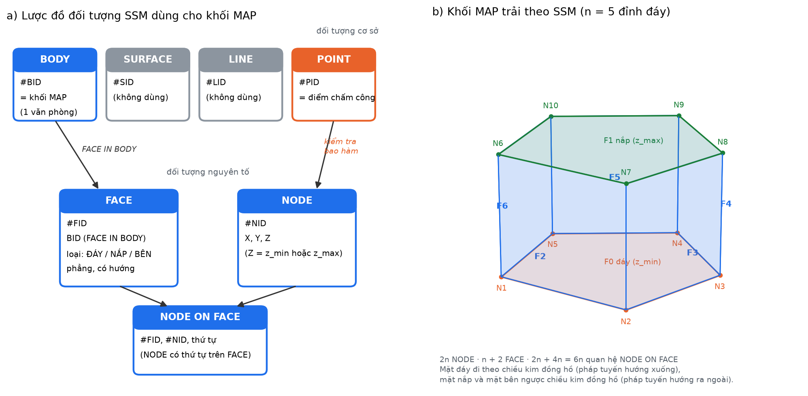

### 2.1.4. Mức chi tiết: LOD1 để tính toán, LOD3 để hiển thị

Theo chuẩn CityGML, mức chi tiết (Level of Detail) của công trình gồm LOD0 (mặt bằng),
LOD1 (khối đùn), LOD2 (thêm hình dạng mái), LOD3 (kiến trúc mặt ngoài: cửa sổ, cửa đi,
chi tiết mái) và LOD4 (nội thất). Đề tài dùng **hai mức cho hai mục đích**:

| Mục đích | Mức | Lý do |
|---|---|---|
| Kiểm tra bao hàm khi chấm công | **LOD1** (khối MAP) | Phép kiểm tra chỉ cần đa giác nền và dải cao độ; chi tiết mặt dựng không làm thay đổi kết quả |
| Hiển thị toà nhà trên bản đồ 3D | **LOD3** | Đáp ứng yêu cầu “bản đồ 3D mức độ chi tiết 3” của môn; người dùng nhận ra toà nhà, tầng, lối vào |

Mô hình LOD3 không dựng tay mà **sinh tự động** từ chính dữ liệu trong CSDL
(footprint, cao độ nền, số tầng, chiều cao tầng, số tầng khối đế). Mỗi thành phần gắn
một lớp ngữ nghĩa CityGML:

| Thành phần LOD3 | Lớp CityGML | Cách dựng |
|---|---|---|
| Băng tường ốp đá khối đế, dầm biên từng tầng, tường chắn mái | `WallSurface` | Khối đùn mỏng theo footprint đã phóng |
| Băng cửa kính khối đế, vách kính thân tháp | `Window` | Khối đùn kính bán trong suốt |
| Cửa xoay, hai cửa kính sảnh chính | `Door` | Đặt ở giữa cạnh dài nhất của khối đế, xoay theo hướng cạnh |
| Mái khối đế, sàn mái tum, sân đỗ trực thăng | `RoofSurface` | Khối đùn / hình trụ dẹt |
| Khung nhôm đứng, mái sảnh, cột sảnh, tum kỹ thuật, thiết bị mái, cột thu lôi | `BuildingInstallation` | Đường 3D dạng hộp, vật thể 3D |

Thêm một toà nhà bằng tab Quản trị là tự có mô hình LOD3; trên bản đồ có nút chuyển
**LOD1 ⇄ LOD3** để so sánh trực tiếp.

## 2.2. Mô hình hoá — Mô hình MAP (Multi-floor Attendance Prism)

### 2.2.1. Định nghĩa

Từ mô hình SSM ở mục 2.1, nhóm chuyên biệt hoá BODY thành một **lăng trụ đứng gắn với
một văn phòng** và bổ sung hai tham số dung sai, đặt tên là **MAP — Khối chấm công
phân tầng**. Khác biệt so với SSM gốc:

| SSM gốc | MAP |
|---|---|
| BODY bất kỳ, bao bởi FACE bất kỳ | BODY luôn là lăng trụ đứng: 1 FACE đáy, 1 FACE nắp, n FACE bên |
| FACE phẳng, lồi | FACE đáy/nắp được phép lõm (giữ nguyên footprint thật) |
| Lưu đầy đủ NODE, FACE, NODE ON FACE | Lưu gọn (P, z_min, z_max); trải ra SSM bằng `ssm_cua_khoi()` khi cần |
| Không có khái niệm sai số | Thêm δxy, δz để bù sai số định vị |
| Toạ độ Z của NODE nhập trực tiếp | z_min, z_max **suy ra** từ dải tầng bằng trigger |

Một khối MAP là bộ:

```
MAP = ( P, z_min, z_max, δxy, δz )
```

| Thành phần | Ý nghĩa |
|---|---|
| `P` | Đa giác nền (footprint) của phần sàn mà văn phòng thuê, hệ WGS84 |
| `z_min` | Cao độ tuyệt đối của sàn tầng thấp nhất mà văn phòng chiếm |
| `z_max` | Cao độ tuyệt đối của trần tầng cao nhất |
| `δxy` | Biên dung sai ngang, bù cho sai số GPS đô thị |
| `δz` | Biên dung sai đứng, bù cho sai số độ cao |

Cao độ được tính từ cao độ nền của toà nhà:

```
z_min = z_nền + (tầng_bắt_đầu − 1) × h_tầng
z_max = z_nền +  tầng_kết_thúc      × h_tầng
```

Khối kiểm tra thực tế là khối MAP đã **nới biên**:

```
MAP⁺ = ( buffer(P, δxy),  z_min − δz,  z_max + δz )
```

### 2.2.2. Phép kiểm tra bao hàm

Với bản ghi chấm công tại điểm `Q = (lon, lat, alt)`:

```
trong_khối(Q, MAP⁺) ⇔ pointInPolygon(Q.xy, buffer(P, δxy))
                    ∧ (z_min − δz) ≤ Q.alt ≤ (z_max + δz)
```

Kết quả phân thành ba trạng thái, thay vì nhị phân đúng/sai:

| Trạng thái | Điều kiện |
|---|---|
| `HOP_LE` | Thoả cả hai điều kiện, và độ chính xác thiết bị báo về ≤ ngưỡng |
| `NGHI_NGO` | Thoả điều kiện ngang nhưng **sai điều kiện đứng**, hoặc độ chính xác kém |
| `NGOAI_VUNG` | Không thoả điều kiện ngang |

Trạng thái `NGHI_NGO` chính là giá trị mà mô hình 2D không thể sinh ra — nó tương ứng
với “đúng toà nhà, sai tầng”.

### 2.2.3. Bốn quy tắc phát hiện bất thường

| Mã | Quy tắc | Cơ sở |
|---|---|---|
| `R1` | Sai tầng | Thoả ngang, lệch đứng vượt `δz` |
| `R2` | Dịch chuyển bất khả thi | Vận tốc suy ra giữa hai bản ghi liên tiếp vượt ngưỡng (ví dụ > 150 km/h) |
| `R3` | Độ chính xác bất thường | `accuracy` báo về quá nhỏ so với thực tế đô thị (dấu hiệu giả lập GPS) hoặc quá lớn |
| `R4` | Trùng thiết bị | Nhiều nhân viên chấm công từ cùng một định danh thiết bị trong khoảng thời gian ngắn |

### 2.2.4. Các đối tượng trong mô hình

| Đối tượng | Vai trò trong mô hình không gian |
|---|---|
| `ToaNha` | Khối bao ngoài, có footprint và cao độ nền — nền cảnh 3D |
| `VanPhong` | Đơn vị thuê, chiếm dải tầng `[tầng_bắt_đầu, tầng_kết_thúc]` |
| `KhuVucChamCong` | Hiện thực của khối MAP (`P`, `z_min`, `z_max`, `δxy`, `δz`) |
| `BanGhiChamCong` | Điểm 3D `(lon, lat, alt)` kèm độ chính xác và thời gian |
| `CanhBaoBatThuong` | Kết quả áp bốn quy tắc R1–R4 lên bản ghi |

## 2.3. Sơ đồ quan hệ của các đối tượng (ERD)

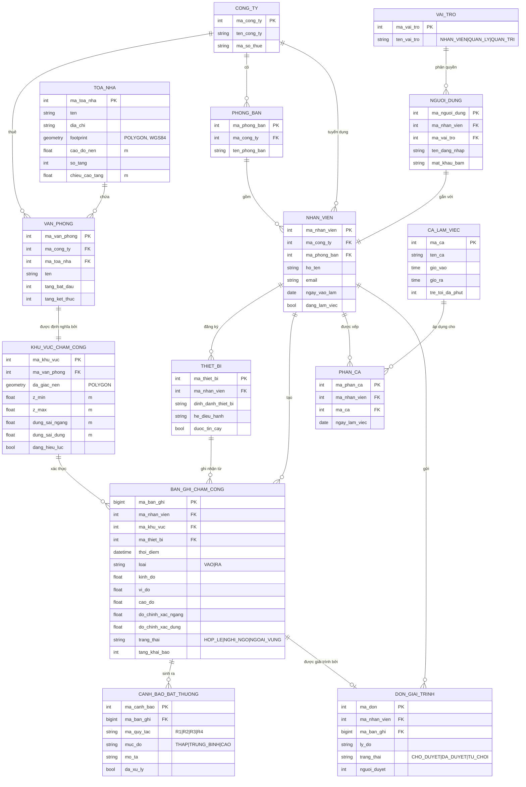

## 2.4. Chuyển ERD thành mô hình quan hệ

```
CONG_TY(ma_cong_ty, ten_cong_ty, ma_so_thue)

PHONG_BAN(ma_phong_ban, ma_cong_ty↑, ten_phong_ban)

TOA_NHA(ma_toa_nha, ten, dia_chi, footprint, cao_do_nen, so_tang, chieu_cao_tang, so_tang_de, nguon_du_lieu)

VAN_PHONG(ma_van_phong, ma_cong_ty↑, ma_toa_nha↑, ten, tang_bat_dau, tang_ket_thuc)

KHU_VUC_CHAM_CONG(ma_khu_vuc, ma_van_phong↑, da_giac_nen, z_min, z_max,
                  dung_sai_ngang, dung_sai_dung, dang_hieu_luc)

NHAN_VIEN(ma_nhan_vien, ma_cong_ty↑, ma_phong_ban↑, ho_ten, email,
          ngay_vao_lam, dang_lam_viec)

THIET_BI(ma_thiet_bi, ma_nhan_vien↑, dinh_danh_thiet_bi, he_dieu_hanh, duoc_tin_cay)

CA_LAM_VIEC(ma_ca, ten_ca, gio_vao, gio_ra, tre_toi_da_phut)

PHAN_CA(ma_phan_ca, ma_nhan_vien↑, ma_ca↑, ngay_lam_viec)

BAN_GHI_CHAM_CONG(ma_ban_ghi, ma_nhan_vien↑, ma_khu_vuc↑, ma_thiet_bi↑,
                  thoi_diem, loai, kinh_do, vi_do, cao_do,
                  do_chinh_xac_ngang, do_chinh_xac_dung, trang_thai, tang_khai_bao)

CANH_BAO_BAT_THUONG(ma_canh_bao, ma_ban_ghi↑, ma_quy_tac, muc_do, mo_ta, da_xu_ly)

DON_GIAI_TRINH(ma_don, ma_nhan_vien↑, ma_ban_ghi↑, ly_do, trang_thai, nguoi_duyet↑)

VAI_TRO(ma_vai_tro, ten_vai_tro)

NGUOI_DUNG(ma_nguoi_dung, ma_nhan_vien↑, ma_vai_tro↑, ten_dang_nhap, mat_khau_bam)
```
*(gạch chân = khoá chính; ↑ = khoá ngoại)*

**Ràng buộc toàn vẹn cần nêu trong báo cáo:**

- `VAN_PHONG.tang_bat_dau ≤ VAN_PHONG.tang_ket_thuc ≤ TOA_NHA.so_tang`
- `KHU_VUC_CHAM_CONG.z_min < z_max`; hai giá trị này **được suy ra** từ `TOA_NHA` và
  `VAN_PHONG` (thuộc tính dẫn xuất — cần nói rõ là lưu trữ phi chuẩn hoá có chủ đích
  để tránh tính lại khi truy vấn nóng).
- Mỗi `NHAN_VIEN` chỉ có tối đa một bản ghi `VAO` chưa có `RA` tương ứng trong ngày.
- `PHAN_CA(ma_nhan_vien, ngay_lam_viec)` là khoá dự tuyển (một người một ca mỗi ngày).

## 2.5. Sơ đồ trường hợp sử dụng (Use Case)

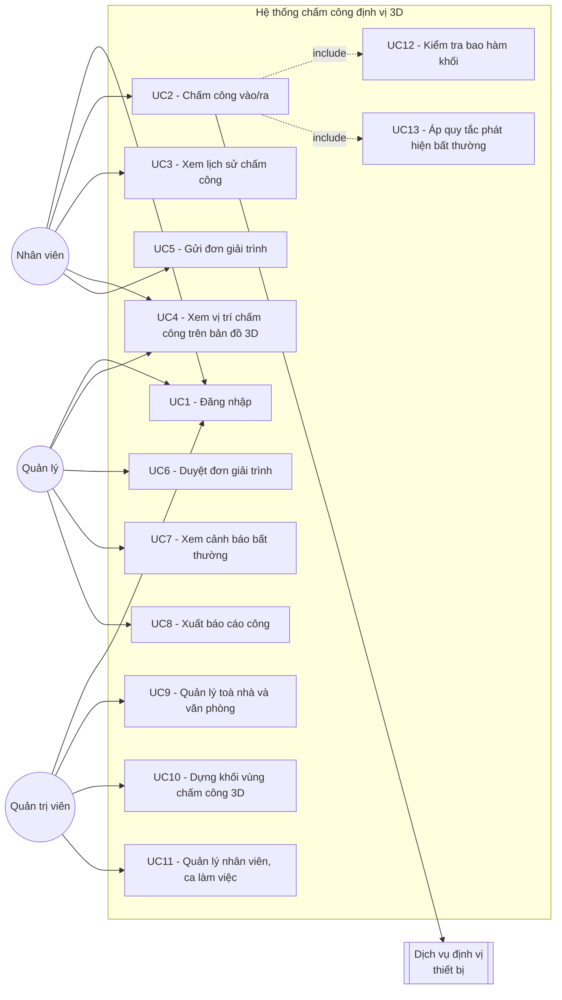

### Đặc tả một số use case chính

**UC2 — Chấm công vào/ra**

| Mục | Nội dung |
|---|---|
| Tác nhân | Nhân viên |
| Tiền điều kiện | Đã đăng nhập; thiết bị đã cấp quyền định vị; có ca làm việc trong ngày |
| Luồng chính | 1. Nhân viên mở màn hình chấm công.<br/>2. Hệ thống yêu cầu vị trí từ thiết bị.<br/>3. Thiết bị trả `(kinh_độ, vĩ_độ, cao_độ, độ_chính_xác)`.<br/>4. Nhân viên xác nhận tầng đang làm việc.<br/>5. Hệ thống thực hiện UC12 (kiểm tra bao hàm khối).<br/>6. Hệ thống thực hiện UC13 (áp R1–R4).<br/>7. Hệ thống lưu bản ghi kèm trạng thái và hiển thị kết quả. |
| Luồng thay thế 3a | Thiết bị không trả được cao độ → dùng tầng khai báo ở bước 4, đánh dấu `nguon_cao_do = KHAI_BAO`. |
| Luồng ngoại lệ 5a | Ngoài vùng ngang → từ chối, gợi ý gửi đơn giải trình (UC5). |
| Luồng ngoại lệ 5b | Trong vùng ngang, lệch tầng → lưu trạng thái `NGHI_NGO`, sinh cảnh báo R1, thông báo cho quản lý. |
| Hậu điều kiện | Có một bản ghi chấm công mới với trạng thái xác định |

**UC10 — Dựng khối vùng chấm công 3D**

| Mục | Nội dung |
|---|---|
| Tác nhân | Quản trị viên |
| Tiền điều kiện | Toà nhà đã tồn tại trong hệ thống |
| Luồng chính | 1. Chọn toà nhà trên SceneView.<br/>2. Vẽ đa giác nền bằng công cụ phác thảo, hoặc kế thừa footprint của toà nhà.<br/>3. Nhập dải tầng của văn phòng.<br/>4. Hệ thống tự tính `z_min`, `z_max` từ cao độ nền và chiều cao tầng.<br/>5. Nhập dung sai `δxy`, `δz`.<br/>6. Hệ thống dựng khối xem trước bằng `ExtrudeSymbol3DLayer`.<br/>7. Lưu khối. |
| Hậu điều kiện | Khối MAP có hiệu lực, dùng để xác thực các lần chấm công sau |

## 2.6. Sơ đồ luồng dữ liệu (DFD)

### DFD mức 0 (sơ đồ ngữ cảnh)

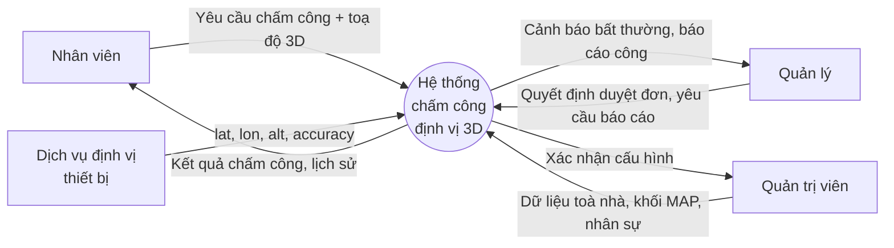

### DFD mức 1

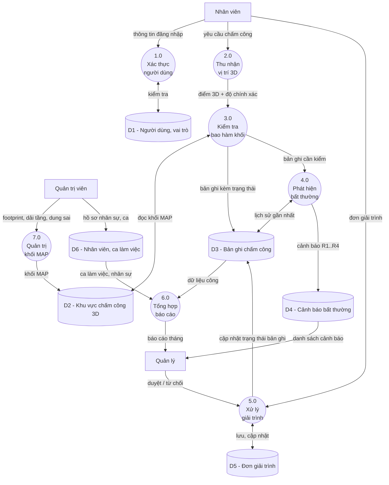

## 2.7. Sơ đồ trình tự (Sequence Diagram)

### SD1 — Chấm công vào (luồng chính + nhánh lệch tầng)

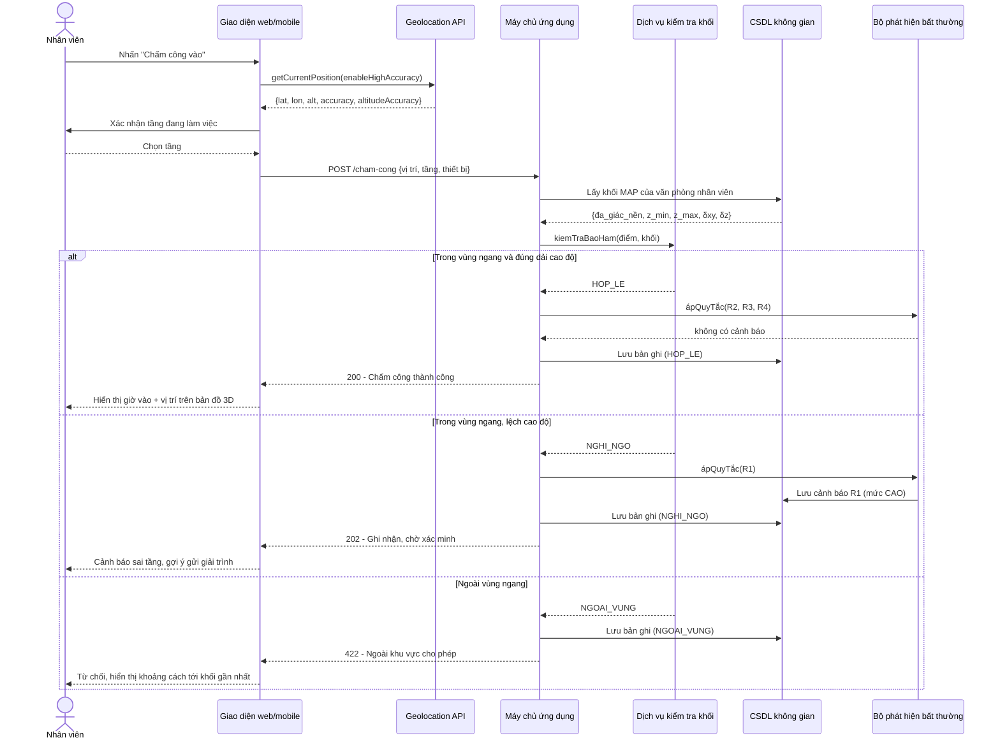

### SD2 — Quản trị viên dựng khối vùng chấm công

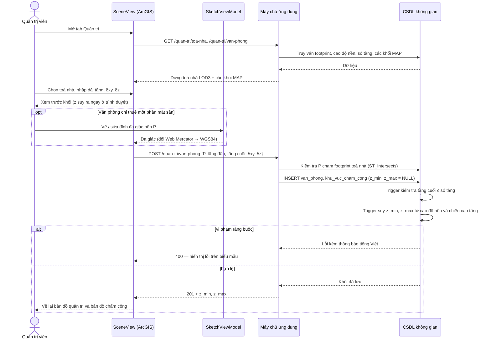

### SD3 — Duyệt đơn giải trình

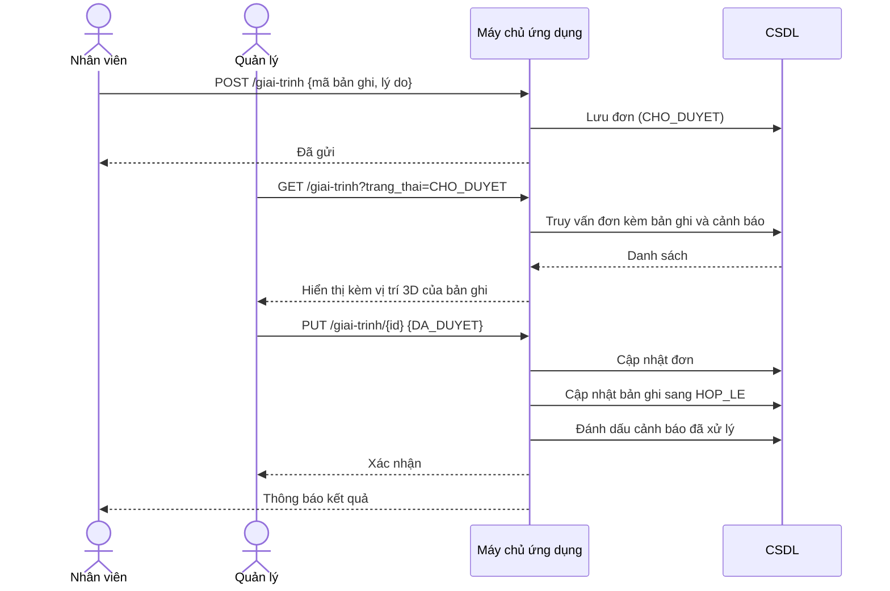

---

# Chương 3: THIẾT KẾ ỨNG DỤNG

## 3.1. Công nghệ sử dụng

| Lớp | Công nghệ | Lý do chọn |
|---|---|---|
| Bản đồ 3D | **ArcGIS Maps SDK for JavaScript 4.29** (`SceneView`, `GraphicsLayer`, `PolygonSymbol3D` + `ExtrudeSymbol3DLayer`, `LineSymbol3D` + `PathSymbol3DLayer`, `ObjectSymbol3DLayer`, `SketchViewModel`) | Đúng công nghệ môn học (Lab 1, Lab 2); dựng được khối đùn, đường 3D và vật thể 3D cho mô hình LOD3; có sẵn công cụ phác thảo đa giác |
| Giao diện | HTML + CSS + JavaScript thuần, không framework | Không cần bước build — máy chủ phục vụ thẳng thư mục `web/`; dễ đọc khi chấm |
| Định vị | HTML5 Geolocation API | Chạy trên trình duyệt di động, không cần cài app |
| Máy chủ | Node.js + Express 5 | Express 5 tự chuyển lỗi của hàm `async` sang bộ bắt lỗi, một yêu cầu sai không làm sập máy chủ |
| **CSDL** | **PostgreSQL 17 + PostGIS 3.5** | Kiểu hình học có Z, `ST_DWithin`/`ST_Distance` trên `geography` cho kết quả bằng mét; logic không gian (kiểm tra bao hàm, R2, trải khối SSM) và ràng buộc (dải tầng, tự tính cao độ) viết bằng PL/pgSQL đặt cạnh dữ liệu |
| Xác thực | JWT + bcrypt | Phân quyền ba vai trò nhân viên / quản lý / quản trị |
| Dữ liệu nền | OpenStreetMap qua Overpass API | Footprint toà nhà; giấy phép ODbL |
| Chạy demo | Windows: PostgreSQL portable + tệp `.bat`; Linux/macOS: Docker + `chay-demo.sh` | Clone về là chạy được một lệnh, không phụ thuộc dịch vụ đám mây |

**Lưu ý bắt buộc:** Geolocation API chỉ hoạt động trên **HTTPS** (hoặc `localhost`).
Khi demo trên điện thoại phải dùng tên miền có chứng chỉ, hoặc `ngrok`.

## 3.2. Giao diện ứng dụng

Tất cả màn hình dưới đây đã được cài đặt và chạy được.

| # | Màn hình | Vai trò | Thành phần chính |
|---|---|---|---|
| 1 | Đăng nhập | mọi người | Biểu mẫu, gợi ý bốn tài khoản thử nghiệm |
| 2 | Chấm công | mọi người | Thông tin văn phòng và khối MAP, thanh chọn tầng, nguồn vị trí GPS / mô phỏng, nút VÀO / RA, kết quả kèm cảnh báo |
| 3 | Bản đồ 3D | mọi người | Toà nhà **LOD3** (chuyển được sang LOD1), các khối MAP bán trong suốt, tấm sàn tầng đang chọn, điểm chấm công đặt đúng cao độ; bấm vào thành phần nào cũng hiện lớp CityGML |
| 4 | Lịch sử chấm công | mọi người | Bảng màu theo trạng thái, gửi giải trình, xuất CSV |
| 5 | Bảng điều khiển quản lý | quản lý | Số liệu tổng hợp, cảnh báo R1–R4, duyệt đơn giải trình, báo cáo công tháng, xuất CSV |
| 6 | Quản trị — Thống kê | quản trị | Số toà nhà, văn phòng, khối hiệu lực, nhân viên, tổng thể tích khối; số lượt chấm công theo từng khối (bấm để bay tới khối) |
| 7 | Quản trị — Toà nhà | quản trị | Thêm / sửa / xoá; **vẽ footprint trên bản đồ 3D**, xem trước mô hình LOD3 ngay khi nhập số tầng |
| 8 | Quản trị — Văn phòng & khối MAP | quản trị | Thêm / sửa / xoá; chọn toà nhà + dải tầng + dung sai, vẽ đa giác riêng nếu chỉ thuê một phần sàn; xem trước khối, báo đỏ nếu vượt số tầng |
| 9 | Quản trị — Nhân viên | quản trị | Thêm / sửa / xoá kèm tài khoản, vai trò; khoá tài khoản (nghỉ việc) mà vẫn giữ lịch sử công |
| 10 | Quản trị — Ca làm việc, công ty, phòng ban | quản trị | Thêm / sửa / xoá; phân ca theo khoảng ngày |

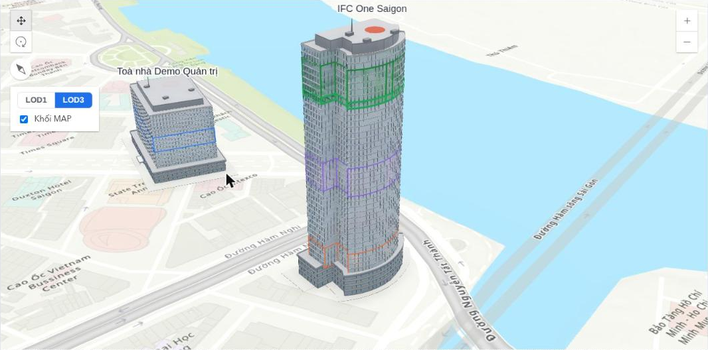
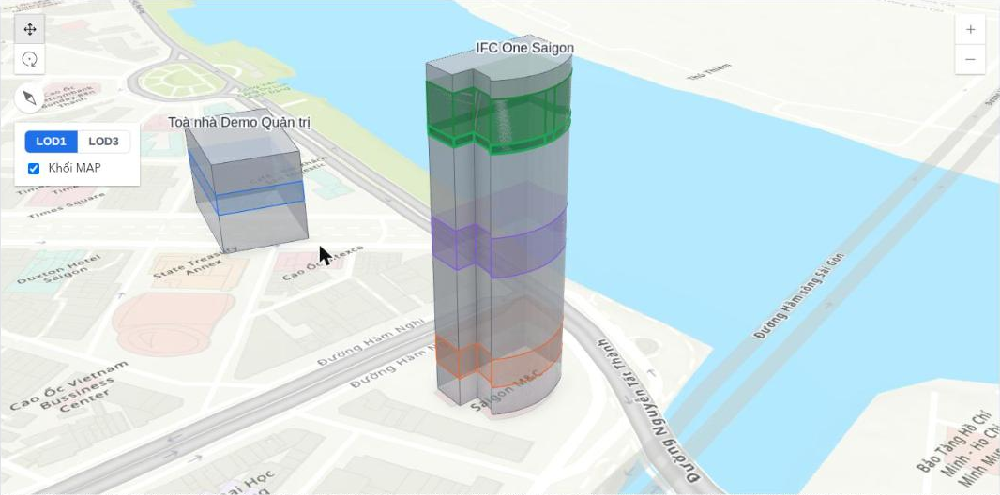
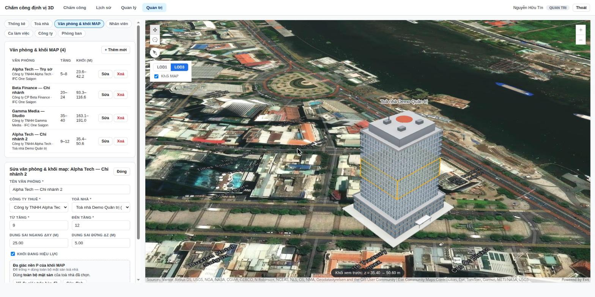

# Chương 4: KẾT QUẢ VÀ ĐỊNH HƯỚNG PHÁT TRIỂN

## 4.1. Kết quả

**Dữ liệu thử nghiệm.** Toà nhà IFC One Saigon (footprint thật OSM way/306578560,
42 tầng, 195,3 m) với ba văn phòng ở ba dải tầng: Alpha Tech 5–8, Beta Finance 20–24,
Gamma Media 35–40. Trigger suy ra đúng các dải 23,60–42,20 m, 93,35–116,60 m,
163,10–191,00 m.

**Ba tình huống của mô hình MAP** (chạy qua giao diện và qua API):

| Tình huống | Cao độ | Hệ 3D | Hàng rào 2D |
|---|---|---|---|
| Nhân viên Alpha Tech chấm công ở tầng 6 | 30,58 m | `HOP_LE` | hợp lệ |
| Cùng toạ độ, khai báo tầng 22 | 104,98 m | `NGHI_NGO` + R1 (lệch 62,78 m ≈ 13,5 tầng) | **hợp lệ — bỏ sót** |
| Cách toà nhà khoảng 300 m | 30,58 m | `NGOAI_VUNG` | ngoài vùng |

(Cao độ khai báo tính ở **giữa tầng**: z_nền + (tầng − 0,5) × h_tầng. Ba câu kiểm thử
cuối `seed.sql` dùng cao độ sàn tầng 6 là 28,25 m, cùng cho kết quả `HOP_LE`.)

**Kiểm thử tự động** `npm test` — 34/34 đạt, gồm:

| Nhóm | Nội dung kiểm thử |
|---|---|
| Mô hình MAP | Ba tình huống trên + sinh cảnh báo R1 |
| Phân quyền | Nhân viên và quản lý bị chặn (403) khỏi API quản trị |
| Thêm / sửa / xoá | Công ty, phòng ban, toà nhà (từ đa giác), văn phòng, nhân viên, ca làm việc |
| Ràng buộc CSDL | Chặn văn phòng vượt số tầng; chặn khối vẽ ra ngoài toà nhà; chặn trùng tên đăng nhập; không xoá toà nhà còn văn phòng; không xoá cứng nhân viên đã có công |
| Tự tính lại khối | Sửa dải tầng 3–5 → 6–7: khối đổi từ 11–23 m sang 23–31 m; sửa chiều cao tầng toà nhà 4 → 5 m: khối bên trong đổi sang 28–38 m |
| Mô hình SSM | Khối hình hộp trải ra đúng 8 NODE, 6 FACE, 24 NODE ON FACE |
| Luồng đầu–cuối | Nhân viên mới tạo đăng nhập được, chấm công trong khối vừa dựng → `HOP_LE`; chuyển sang nghỉ việc → không đăng nhập được nữa |

**Đáp ứng yêu cầu môn học:**

| Yêu cầu (Danh sách đồ án 2026) | Đáp ứng |
|---|---|
| Thêm, xoá, sửa dữ liệu | Tab Quản trị: 6 loại dữ liệu + phân ca |
| Thống kê dữ liệu | Bảng điều khiển quản lý, báo cáo công tháng, thống kê theo khối, xuất CSV |
| Hiển thị thực thể không gian trên bản đồ | Toà nhà, khối MAP, tấm sàn, điểm chấm công trên SceneView |
| Bản đồ 3D mức độ chi tiết 3 | Toà nhà LOD3 sinh tự động, có lớp ngữ nghĩa CityGML |

## 4.2. Hạn chế cần nêu trung thực

Đây là phần làm điểm — không được giấu:

1. **Độ cao GPS trong nhà rất kém.** Tín hiệu vệ tinh gần như không thu được trong
   lòng nhà cao tầng; `altitude` mà `Geolocation API` trả về thường là `null` hoặc có
   `altitudeAccuracy` hàng chục mét — lớn hơn cả chiều cao vài tầng. Do đó mô hình
   phải chấp nhận **nguồn cao độ hỗn hợp**: ưu tiên cao độ đo được, khi không có thì
   dùng tầng do người dùng khai báo, và hệ thống chỉ *đối chiếu* chứ không *quyết định
   một mình*.
2. **Chưa dùng cảm biến bổ trợ.** Giải pháp công nghiệp cho định vị trong nhà là
   Wi-Fi RSSI / BLE beacon / khí áp kế. Trong phạm vi đồ án chỉ nêu hướng, không cài đặt.
3. **Dữ liệu chiều cao toà nhà từ OSM rất thiếu** — khảo sát cho thấy chỉ khoảng
   3,7 % công trình ở TP.HCM có thuộc tính `height` hoặc `building:levels`, nên phải
   nhập tay cho toà nhà thử nghiệm.
4. **Giả lập GPS cấp hệ điều hành** không thể chặn hoàn toàn từ phía web; các quy tắc
   R2–R4 chỉ làm tăng chi phí gian lận chứ không loại bỏ được.

## 4.3. Định hướng phát triển

- Bổ sung định vị trong nhà bằng BLE beacon đặt theo tầng, hợp nhất với mô hình MAP.
- Nâng lên **LOD4** (nội thất: từng phòng, hành lang, lõi thang) để chấm công theo khu
  vực làm việc thay vì theo cả dải tầng; khi đó mỗi phòng là một BODY của SSM.
- Phân tích vùng che khuất tín hiệu GPS dựa trên mô hình khối các toà nhà lân cận, để
  tự động hiệu chỉnh dung sai `δxy` theo từng vị trí.
- Mở rộng cho công trường xây dựng: khối MAP theo cao độ thi công thay đổi theo thời
  gian (chiều thứ tư — thời gian).
- Tích hợp với hệ thống tính lương.

---

# Phụ lục A — Phân công gợi ý cho nhóm

| Vai trò | Công việc | Sản phẩm |
|---|---|---|
| Thành viên 1 | Mô hình dữ liệu, PostGIS, ERD, mô hình quan hệ | Script SQL, Chương 2.3–2.4 |
| Thành viên 2 | Backend API, thuật toán kiểm tra khối, quy tắc R1–R4 | Mã nguồn API, Chương 2.2 |
| Thành viên 3 | Bản đồ 3D ArcGIS, công cụ dựng khối MAP | Màn hình 4 và 7, Chương 3.2 |
| Thành viên 4 | Giao diện chấm công, lịch sử, báo cáo, kiểm thử thực địa | Màn hình 1–3, 5–6, 8, Chương 4.1 |

# Phụ lục B — Việc cần làm trước buổi bảo vệ

- [x] Chọn toà nhà thử nghiệm, đo/tra cao độ nền và chiều cao tầng.
- [x] Lấy footprint từ Overpass, kiểm tra lại bằng ảnh vệ tinh.
- [x] Nhập ít nhất 3 văn phòng ở 3 dải tầng khác nhau trong cùng toà nhà.
- [x] Chức năng thêm / sửa / xoá và thống kê (yêu cầu chung của môn).
- [x] Bản đồ 3D mức chi tiết 3 (LOD3).
- [ ] Bổ sung đủ thành viên theo quy định 6–8 sinh viên / nhóm và bảng phân công thật
      (Phụ lục A hiện mới có 4 người).
- [ ] Quay video demo (nộp Moodle kèm báo cáo PDF, PPT, mã nguồn, bảng phân công).
- [ ] Quay video thử nghiệm thực địa: chấm công đúng tầng, sai tầng, ngoài toà nhà.
- [ ] Chuẩn bị trả lời câu hỏi: *“vì sao không dùng geofence 2D?”* — dùng đúng ví dụ ở
      mục 1.2(a); *“vì sao chọn SSM mà không chọn UDM?”* — mục 2.1.2.
