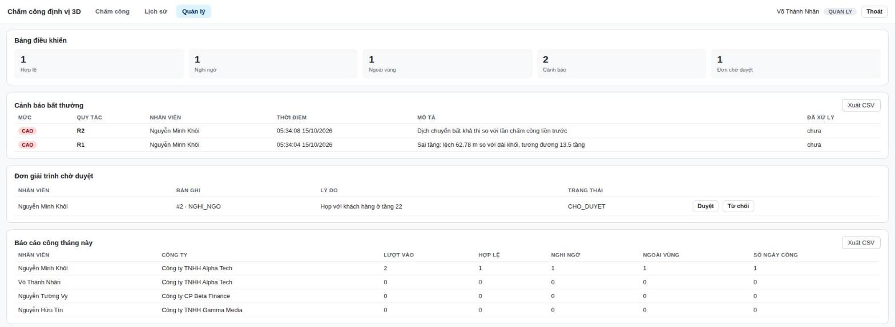

# Hệ thống chấm công định vị 3D

Đồ án môn **IE402 — Hệ thống thông tin địa lý 3 chiều**, nhóm 1.
GVHD: ThS. Phan Thanh Vũ.

Bài toán: hàng rào địa lý hai chiều không phân biệt được người lao động đang ở tầng
nào trong một cao ốc — nhân viên tầng 5 và tầng 22 có **cùng toạ độ kinh/vĩ độ**.
Hệ thống thay phép kiểm tra *"điểm thuộc đa giác"* bằng *"điểm thuộc khối"*, sinh ra
trạng thái mà hệ 2D không tạo được: **đúng toà nhà, sai tầng**.

---

## 1. Chạy hệ thống

### 1.0a Linux / macOS — một lệnh

Cần **Node.js LTS** và **Docker**. Từ thư mục `ie402-chamcong-3d/`:

```bash
./chay-demo.sh              # dựng PostGIS bằng Docker, nạp dữ liệu, cài thư viện, bật máy chủ, mở trình duyệt
./chay-demo.sh --kiem-thu   # như trên + chạy 34 ca kiểm thử tự động
./chay-demo.sh --lam-moi    # nạp lại dữ liệu mẫu (xoá các bản ghi lúc tập dượt)
./tat-demo.sh               # tắt máy chủ và CSDL (dữ liệu vẫn giữ)
```

Lần đầu Docker tải image `postgis/postgis:17-3.5` (~600 MB). CSDL chỉ nghe
`127.0.0.1:55432`, đúng giá trị mặc định trong `server/src/db.js`.

### 1.0b Clone về rồi chạy — Windows

Repo **không chứa** `node_modules/` và cũng không chứa PostgreSQL, nên sau khi clone
phải cài một lần trước khi chạy được.

| Bước | Việc làm |
|---|---|
| 1 | Cài **Node.js LTS** (https://nodejs.org) |
| 2 | Dựng **PostgreSQL + PostGIS** theo [`db/README.md`](db/README.md) — có hướng dẫn bản portable, không cần Docker, không cần quyền admin |
| 3 | Nhấp đúp **`CAI-DAT.bat`** — chạy `npm install`, tạo CSDL `chamcong3d`, bật PostGIS, nạp `schema.sql` và `seed.sql`. **Chỉ chạy một lần.** |
| 4 | Nhấp đúp **`BAT-DEMO.bat`** — bật PostgreSQL, bật máy chủ, tự mở trình duyệt |
| 5 | Xong việc thì nhấp đúp **`TAT-DEMO.bat`** |

`CAI-DAT.bat` và `BAT-DEMO.bat` tự tìm thư mục `bin` của PostgreSQL ở các vị trí quen
thuộc (`D:\pgportable\pgsql\bin`, `C:\pgportable\pgsql\bin`, bản cài đặt chuẩn, hoặc
`psql` có sẵn trong `PATH`). Nếu cài ở chỗ khác thì chỉ cần đặt biến môi trường:

```powershell
set PGBIN=D:\duong\dan\pgsql\bin
```

### 1.1 Cơ sở dữ liệu (làm tay, nếu không dùng .bat)

```powershell
$bin = "D:\pgportable\pgsql\bin"
& "$bin\createdb.exe" -h 127.0.0.1 -p 55432 -U postgres chamcong3d
& "$bin\psql.exe" -h 127.0.0.1 -p 55432 -U postgres -d chamcong3d -c "CREATE EXTENSION postgis;"
& "$bin\psql.exe" -h 127.0.0.1 -p 55432 -U postgres -d chamcong3d -f db\schema.sql
& "$bin\psql.exe" -h 127.0.0.1 -p 55432 -U postgres -d chamcong3d -f db\seed.sql
```

`seed.sql` tự kiểm chứng ngay khi nạp: in ra kết quả ba kịch bản TH1 `HOP_LE`,
TH2 `NGHI_NGO`, TH3 `NGOAI_VUNG` và dải cao độ của ba văn phòng.

### 1.2 Máy chủ (làm tay)

```bash
cd server
npm install
npm start
```

Mở **http://127.0.0.1:3000** — máy chủ phục vụ luôn cả giao diện web trong `web/`.
Kiểm tra sống bằng **http://127.0.0.1:3000/healthz**.

> Không bắt buộc tạo `.env`: `server/src/db.js` đã có sẵn giá trị mặc định
> (`127.0.0.1:55432`, user `postgres`, database `chamcong3d`). Chỉ cần sao chép
> `.env.example` thành `.env` khi máy bạn dùng cổng hoặc mật khẩu khác.

### 1.3 Tài khoản thử nghiệm

Mật khẩu của cả bốn tài khoản đều là `123456`.

| Tài khoản | Họ tên | Vai trò | Văn phòng |
|---|---|---|---|
| `khoi.nm` | Nguyễn Minh Khôi | Nhân viên | Alpha Tech — tầng 5–8 |
| `nhan.vt` | Võ Thành Nhân | Quản lý | Alpha Tech |
| `vy.nt` | Nguyễn Tường Vy | Nhân viên | Beta Finance — tầng 20–24 |
| `tin.nh` | Nguyễn Hữu Tín | Quản trị | Gamma Media — tầng 35–40 |

| Vai trò | Thấy các tab |
|---|---|
| Nhân viên | Chấm công, Lịch sử |
| Quản lý | + **Quản lý** (cảnh báo, duyệt đơn, báo cáo công) |
| Quản trị | + **Quản trị** (thêm / sửa / xoá toà nhà, văn phòng & khối MAP, nhân viên, ca, công ty, phòng ban; thống kê) |

> Geolocation API chỉ chạy trên **HTTPS hoặc localhost**. Mở bằng địa chỉ IP nội bộ
> sẽ bị trình duyệt từ chối cấp quyền định vị — khi đó dùng nút **Mô phỏng** để bấm
> chọn vị trí trên bản đồ.

---

## 2. Kịch bản trình diễn

1. Đăng nhập `khoi.nm` (Alpha Tech, tầng 5–8).
2. Chọn **Mô phỏng**, bấm vào giữa toà nhà trên bản đồ 3D, để tầng ở **6** → chấm công
   VÀO → kết quả **HỢP LỆ**.
3. Kéo tầng lên **22** rồi chấm công lại → **NGHI NGỜ**, kèm cảnh báo **R1** báo lệch
   62,78 m ≈ 13,5 tầng. *Đây là tình huống hàng rào 2D kết luận hợp lệ.*
4. Bấm ra ngoài toà nhà rồi chấm công → **NGOÀI VÙNG**; sang tab **Lịch sử** bấm
   *Gửi giải trình*.
5. Đăng nhập `nhan.vt` → tab **Quản lý**: xem bảng điều khiển, danh sách cảnh báo
   R1–R4, duyệt đơn giải trình (bản ghi tự chuyển sang HỢP LỆ và cảnh báo được đóng),
   xem báo cáo công.
6. Đăng nhập `tin.nh` → tab **Quản trị**:
   - **Toà nhà → + Thêm mới**: nhập tên, số tầng, chiều cao tầng, số tầng đế → **Vẽ đa
     giác trên bản đồ** (bấm từng đỉnh, bấm đúp để kết thúc) → mô hình **LOD3** hiện
     ngay để xem trước → **Lưu**.
   - **Văn phòng & khối MAP → + Thêm mới**: chọn công ty, toà nhà, dải tầng → khối
     xem trước màu vàng; nhập vượt số tầng thì khối báo đỏ và CSDL từ chối khi lưu.
   - Nút **LOD1 / LOD3** ở góc bản đồ để so sánh hai mức chi tiết.

> Dùng ba tài khoản trên **cùng một trình duyệt** trong vòng 10 phút sẽ sinh cảnh báo
> **R4 — trùng thiết bị** (đúng thiết kế). Khi trình diễn nên mở cửa sổ ẩn danh cho
> từng tài khoản.




---

## 3. Cấu trúc mã nguồn

```
ie402-chamcong-3d/
├── chay-demo.sh / tat-demo.sh   Chạy / tắt demo một lệnh trên Linux, macOS (Docker)
├── server/                 Máy chủ Node.js + Express 5
│   ├── scripts/kiem-thu.js Kiểm thử đầu–cuối qua API (npm test, 34 ca)
│   └── src/
│       ├── index.js        Khởi tạo app, đăng nhập, phục vụ web tĩnh, đổi lỗi CSDL sang HTTP
│       ├── db.js           Kết nối PostgreSQL
│       ├── auth.js         JWT + phân quyền theo vai trò
│       ├── csv.js          Xuất CSV cho Excel (BOM UTF-8 + sep=;)
│       └── routes/
│           ├── chamcong.js Chấm công, lịch sử, gửi giải trình, toà nhà, khối SSM
│           ├── quanly.js   Cảnh báo, duyệt đơn, dashboard, báo cáo
│           └── quantri.js  Thêm / sửa / xoá dữ liệu nền + thống kê
├── web/                    Giao diện (không dùng framework)
│   ├── index.html
│   ├── app.js              Đăng nhập, chấm công, lịch sử, quản lý, bản đồ chấm công
│   ├── mo-hinh-3d.js       Dựng toà nhà LOD1 / LOD3 và khối MAP từ dữ liệu CSDL
│   ├── quan-tri.js         Tab Quản trị: biểu mẫu, vẽ đa giác (SketchViewModel), xem trước
│   └── style.css
├── db/
│   ├── schema.sql          14 bảng, 8 hàm, 4 trigger (gồm hàm trải khối theo mô hình SSM)
│   ├── seed.sql            Toà nhà IFC One Saigon + 3 văn phòng + 4 nhân viên
│   └── README.md           Cách dựng PostGIS và kết quả đã kiểm chứng
├── prototype/              Bản dựng đầu tiên: chỉ thuật toán, chạy hoàn toàn ở trình duyệt
├── tools/                  Script sinh tài liệu và sơ đồ
└── docs/                   Sơ đồ đã kết xuất và ảnh chụp màn hình
```

## 4. API

| Phương thức | Đường dẫn | Quyền | Chức năng |
|---|---|---|---|
| POST | `/api/dang-nhap` | — | Đăng nhập, trả JWT |
| GET | `/api/toi` | đã đăng nhập | Thông tin nhân viên + khối MAP của họ |
| GET | `/api/khu-vuc` | đã đăng nhập | Danh sách khối MAP để vẽ bản đồ 3D |
| POST | `/api/cham-cong` | đã đăng nhập | Chấm công: kiểm tra bao hàm khối + áp R1–R4 |
| GET | `/api/cham-cong/lich-su` | đã đăng nhập | Lịch sử của chính mình |
| POST | `/api/giai-trinh` | đã đăng nhập | Gửi đơn giải trình |
| GET | `/api/giai-trinh` | quản lý | Danh sách đơn |
| PUT | `/api/giai-trinh/:id` | quản lý | Duyệt / từ chối |
| GET | `/api/canh-bao` | quản lý | Cảnh báo bất thường |
| GET | `/api/dashboard` | quản lý | Số liệu tổng hợp |
| GET | `/api/bao-cao/cong` | quản lý | Báo cáo công theo tháng |
| GET | `/api/cham-cong/lich-su.csv` | đã đăng nhập | Xuất lịch sử của chính mình ra CSV |
| GET | `/api/canh-bao.csv` | quản lý | Xuất cảnh báo ra CSV |
| GET | `/api/bao-cao/cong.csv` | quản lý | Xuất báo cáo công ra CSV |
| GET | `/api/toa-nha` | đã đăng nhập | Danh sách toà nhà để dựng mô hình LOD1 / LOD3 |
| GET | `/api/khu-vuc/:id/ssm` | đã đăng nhập | Khối MAP trải theo mô hình SSM (NODE, FACE, dung lượng) |
| GET, POST | `/api/quan-tri/{loại}` | quản trị | Danh sách / thêm mới. `{loại}` = `toa-nha`, `van-phong`, `nhan-vien`, `ca-lam-viec`, `cong-ty`, `phong-ban` |
| PUT, DELETE | `/api/quan-tri/{loại}/:id` | quản trị | Sửa / xoá |
| GET, POST, DELETE | `/api/quan-tri/phan-ca` | quản trị | Lịch 7 ngày, gán ca theo khoảng ngày, bỏ một ca |
| GET | `/api/quan-tri/thong-ke` | quản trị | Thống kê dữ liệu nền và số lượt chấm công theo khối |

Lỗi ràng buộc của CSDL được đổi thành mã HTTP dễ hiểu: còn dữ liệu tham chiếu → 409,
trùng giá trị → 409, vi phạm trigger (ví dụ văn phòng vượt số tầng) → 400 kèm câu
thông báo tiếng Việt từ trigger.

## 4b. Kiểm thử

```bash
cd server && npm test     # máy chủ phải đang chạy
```

34 ca: ba tình huống MAP, phân quyền, thêm/sửa/xoá từng loại dữ liệu, các ràng buộc
CSDL, tự tính lại khối khi sửa tầng / chiều cao tầng, trải khối SSM, luồng nhân viên
mới. Kịch bản tự dọn dữ liệu do nó tạo ra.

## 5. Bốn quy tắc phát hiện bất thường

| Mã | Quy tắc | Cài đặt |
|---|---|---|
| R1 | Sai tầng | Trạng thái `NGHI_NGO` kèm độ lệch cao độ, quy ra số tầng |
| R2 | Dịch chuyển bất khả thi | Hàm `kiem_tra_r2()` trong PostGIS, ngưỡng 150 km/h |
| R3 | Độ chính xác bất thường | `accuracy` < 1 m (nghi giả lập GPS) hoặc > 100 m |
| R4 | Trùng thiết bị | Cùng định danh thiết bị, khác nhân viên, trong 10 phút |

## 6. Ghi chú về bảo mật

Đây là môi trường học tập: CSDL dùng `-A trust` và chỉ nghe `127.0.0.1`, khoá JWT để
ở giá trị mặc định trong `.env.example`. Mọi chuỗi người dùng nhập (tên, lý do giải
trình…) đều được escape trước khi đưa vào HTML để tránh XSS lưu trữ. Khi triển khai thật phải đổi sang
`scram-sha-256`, sinh `JWT_SECRET` ngẫu nhiên và chạy sau HTTPS.
